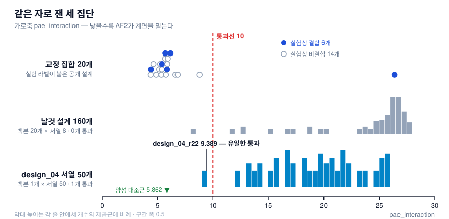
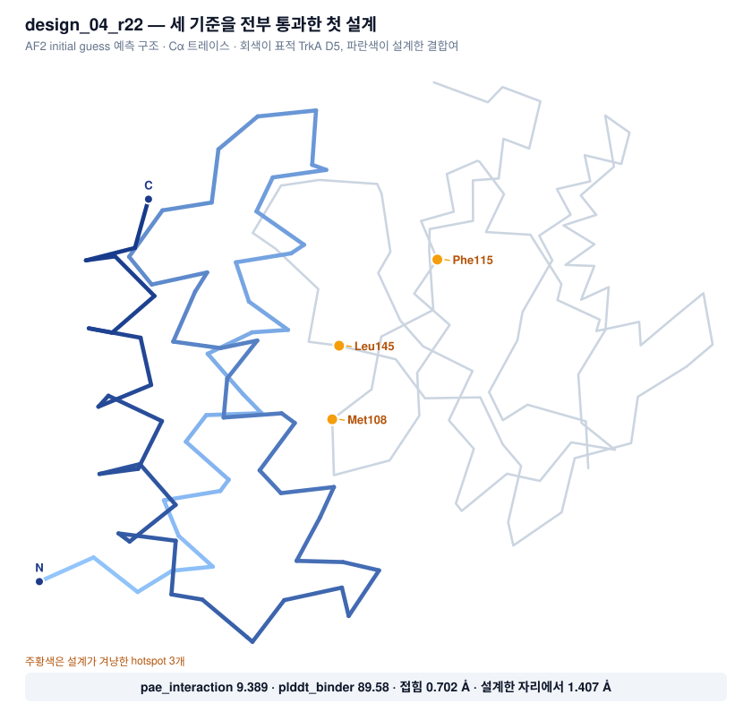

# TrkA 결합체 설계 — 파이프라인 재현과 채점 지표 교정

RFdiffusion3 → LigandMPNN → AlphaFold2 initial guess를 Colab T4에서 돌린다. 공개된 실험
라벨로 채점 기준을 먼저 교정하고, 그 다음 직접 설계한 결합여를 같은 기준으로 쟀다.
실험 수단은 없다.

| 고정한 것 | 값 |
| --- | --- |
| 표적 | TrkA D5 도메인, 공개 설계 좌표계 |
| 에피토프 | Met108 · Phe115 · Leu145 (공개 결합여 TrkA_88의 최심부 소수성 접촉) |
| 통과 기준 | `pae_interaction` < 10, `plddt_binder` > 80, 접힘 RMSD < 1 Å (Watson 2023) |
| 양성 대조군 | TrkA_88을 모든 채점 배치에 동봉 |

## 실행과 결과

| 실행 | 조건 | 결과 |
| --- | --- | --- |
| [단량체 자기일관성](results/2026-11-16-monomer-selfconsistency) | 표적 없음, 백본 2 × 서열 10 | 20개 중 16개가 Cα RMSD < 2 Å, 최소 0.512 Å |
| [TrkA_88 재현](docs/issues/2026-11-18-trka-target-sidechains.md) | 공개 설계 1건 | 1차 실패(31.1 Å) → 표적 사이드체인 이식 후 **1.496 Å, `pae` 5.862** (논문 1.4 Å) |
| [지표 교정](docs/02-filter-calibration.md) | 실험 라벨된 공개 설계 20개 | 비결합 **14/14 통과**, 결합 5/6 통과 |
| [설계 v0.1.0](docs/03-design-run.md) | 백본 20 × 서열 2 = 40 | **0/40 통과**, `pae` 최소 10.235 |
| [설계 v0.2.0](docs/04-scale-run.md) | 길이 4종 고정, 백본 20 × 서열 8 = 160 | **0/160 통과**, `pae` 최소 8.480 (접힘 1.121 Å로 탈락) |
| [집중 v0.3.0](docs/05-focus-run.md) | `design_04` 1개 × 서열 50 | **1/50 통과 — `design_04_r22`** |

## 결정과 근거

| 관찰 | 결정 |
| --- | --- |
| 재현이 두 경로(ColabDesign·업스트림)에서 같은 양상으로 실패 | 설정 탐색을 멈추고 12조건 통제 실험 → 원인은 표적 사이드체인 누락 |
| 교정 집합 95개는 저자들이 이미 계산 필터를 통과시켜 실험에 보낸 집합 | 선별을 안 거친 날것을 직접 설계해 측정 |
| 채점 2531초 중 1564초(62%)가 JAX 재컴파일. contig `70-95`가 길이 17종을 뽑음 | 길이를 73·80·87·93으로 고정 → 컴파일 4회(9.2%), 설계당 61.7초 → 25.5초 |
| 백본 좌표 기하 설명자 8종과 AF2 결과의 상관이 \|r\| ≤ 0.24 | AF2 앞 값싼 사전 필터 안을 폐기 |
| 백본 20개의 첫 서열이 전부 평탄면(24.9–27.5). 최저값 2개는 서열 8개 중 1개에서만 나옴 | "서열 줄이고 백본 늘리자"를 철회, 서열 8개 유지 |
| `design_04`가 배치 1.190 Å인데 `pae` 12.934에서 멈춤 | 같은 백본에 서열 50개 재추출 → 통과 1개 |

## 통과한 설계

| `design_04_r22` | 값 | 기준 |
| --- | --- | --- |
| `pae_interaction` | 9.389 | < 10 |
| `plddt_binder` | 89.58 | > 80 |
| 접힘 RMSD | 0.702 Å | < 1 |
| 설계 위치와의 거리 | 1.407 Å | (대조군 1.497 Å) |

같은 백본 50개 중 `plddt` > 80이 50, 접힘 < 1 Å가 47, 배치 < 5 Å가 41, `pae` < 20이 27.
넓은 실행 160개에서는 각각 126, 63, 11, 10이었다.

## 한계

| 항목 | 상태 |
| --- | --- |
| 실험 검증 | 없음. 교정 집합에서 실험상 비결합 14개가 전부 같은 기준을 통과했다 |
| 통과의 의미 | 공개 95개 중 실제 결합은 6개(6.3%). 통과는 그 확률을 얻는 지점이다 |
| 통과율 | 0/160의 95% 상한 1.85%. 하한은 못 쟀다 |
| 논문과의 비교 | 생성 모델이 RFdiffusion**3**, 논문은 1. 성공률을 직접 비교할 수 없다 |
| 미규명 | 배치가 1.19 Å로 맞는 백본에서 `pae`가 왜 12.9에 머무는지 |

## 문서

| 문서 | 내용 |
| --- | --- |
| [00-purpose](docs/00-purpose.md) | 취지, 범위, 단계별 성공의 정의, 작업 순서 |
| [01-pipeline](docs/01-pipeline.md) | 파이프라인 단계, 지표 정의, 통과 기준, 검증 지점 |
| [02-filter-calibration](docs/02-filter-calibration.md) | 교정 — 라벨된 20개의 분포와 한계 |
| [03-design-run](docs/03-design-run.md) | 설계 40개 — 채점 결과, 소요 시간 분해 |
| [04-scale-run](docs/04-scale-run.md) | 설계 160개 — 재컴파일 수정 검증, 백본별 분해, 통과율 상한 |
| [05-focus-run](docs/05-focus-run.md) | 백본 1개 × 서열 50 — 첫 통과, 백본·서열 중 어느 쪽이 한계였나 |
| [history](docs/history.md) | 각 실행이 다음 결정을 어떻게 바꿨는지, 버린 선택 |
| [issues/](docs/issues/) | 생긴 문제와 대처. 원인 미규명 건은 그렇게 적는다 |
| [references](docs/references.md) | 논문, 공개 데이터, 고정한 업스트림 리비전과 가중치 |

## 폴더

| 폴더 | 내용 |
| --- | --- |
| [notebooks/](notebooks/) | Colab 실행 진입점 |
| [src/](src/) | [af2_filter](src/af2_filter) 채점, [rfd3_design](src/rfd3_design) 설계, [figures.py](src/figures.py) 그림 생성 |
| [inputs/](inputs/) | 공개 설계 구조·서열·실험 라벨·설계 사양 |
| [results/](results/) | 실행 하나당 폴더 하나. 설정·입력 해시·지표·구조·로그 |
| [diagnostics/](diagnostics/) | 조건 비교 실험 |
| [docs/figures/](docs/figures/) | 위 두 그림. `python src/figures.py`로 결과 파일에서 다시 만든다 |

## 실행

| 노트북 | 용도 | 소요 |
| --- | --- | --- |
| [01_af2_filter_T4](notebooks/01_af2_filter_T4.ipynb) | TrkA_88 1건 채점 — 재현 확인 | 7분 |
| [02_calibrate_filter_T4](notebooks/02_calibrate_filter_T4.ipynb) | 라벨된 20개 채점 — 지표 교정 | 40분 |
| [03_design_trka_T4](notebooks/03_design_trka_T4.ipynb) | 새 결합여 160개 설계·채점 | 1.75시간 |
| [04_focus_design04_T4](notebooks/04_focus_design04_T4.ipynb) | 백본 1개에 서열 50개 재추출·채점 | 30분 |
| [90_af2_conditions_T4](diagnostics/90_af2_conditions_T4.ipynb) | 12조건 비교로 실패 원인 분리 | 25분 |

소요는 설치 포함 실측이다. 노트북은 **clone한 코드**를 돌리므로 코드를 고치면 push 후
실행한다. 실행마다 ZIP 하나가 나오고, [results/](results/) 아래 날짜 폴더로 풀어 보존한다.

## 재현성

- 업스트림 AF2 실행 코드를 커밋 `cafa3853ac94dceb1b908c8d9e6954d71749871a`로 고정한다.
- AF2 가중치는 `alphafold_params_2022-12-06`의 `params_model_1_ptm`, SHA-256 기록.
- 실행마다 입력 파일 SHA-256과 저장소 커밋 해시를 `source.json`에 남긴다.
- 과거 실행의 지표는 기준이 바뀌어도 원래 값으로 둔다. 재평가는 새 폴더에 한다.
- 재구성 이전 상태는 태그 `archive/2026-11-18-pre-restructure`에 있다.
