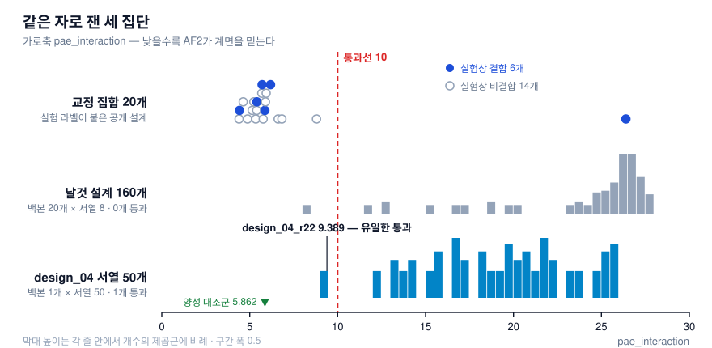

# 설계 실행 160개 (v0.2.0)

[results/2026-11-19-trka-design-v2](../results/2026-11-19-trka-design-v2) · 코드 `6aa8b9a` ·
2026-11-19 · Colab T4 · 104.9분

[앞 실행](03-design-run.md)에서 길이 고정으로 아낀 시간을 설계 수에 투입. 40개 → 160개,
벽시계 62.6분 → 104.9분.

## 결과

| 항목 | 값 |
| --- | --- |
| 채점 | 160개 (길이 4종 × 백본 5 × 서열 8) + 대조군 1 |
| 통과 | **0개** |
| 최저 `pae_interaction` | **8.480** — 통과선 아래 첫 사례 |
| 대조군 TrkA_88 | 5.862, 앞 실행과 소수점까지 동일 |

`design_13_seq03`이 `pae` 8.480 / `plddt` 86.04로 두 기준 통과, 접힘 1.121 Å로 0.121 Å
부족해 탈락.

대조군이 다른 VM·다른 배치에서 같은 값 — 채점 경로가 결정적.

## 길이 고정 효과

| 항목 | v0.1.0 (40개) | v0.2.0 (160개) |
| --- | --- | --- |
| 길이 종류 = 컴파일 횟수 | 17회 | **4회** |
| 컴파일 시간 | 1564초 (62%) | **378초 (9.2%)** |
| 채점 단계 | 2531초 | 4099초 |
| 설계당 채점 | 61.7초 | **25.5초** |
| 시간당 설계 | 58개 | **141개** |

컴파일 1회당 비용은 불변. 느린 4회가 99.7 / 102.8 / 107.9 / 110.1초, 나머지 157회
중앙값 10.7초 — 차이 약 92초로 앞 실행 측정치 92.0초와 일치. 줄어든 것은 횟수뿐.

변경 범위는 코드 상수 하나와 contig 첫 필드. 업스트림 `predict.py`는 고정 리비전 그대로,
recycle도 3 유지.

## 설계 단계 점검

[interface_check.txt](../results/2026-11-19-trka-design-v2/interface_check.txt)

| 항목 | 값 |
| --- | --- |
| 결합여 길이 | 73·80·87·93 각 5개 — 요청대로 4종 |
| Met108 접촉 | 20/20, 최단 1.06–3.68 Å |
| Leu145 접촉 | 20/20, 최단 2.52–4.14 Å |
| Phe115 접촉 | 6/20 |
| 계면 표적 잔기 | 14–36개 |
| 준비 실패 | 0건 |

설계 코드가 요청과 다른 길이를 받으면 중단하도록 해 둠. 중단 없음.

Phe115는 앞 실행 8/20, 이번 6/20 — RFdiffusion3가 지정 hotspot 3개 중 이 하나를
일관되게 비껴감.

## 기준별 탈락

| 기준 | v0.1.0 | v0.2.0 | 대조군 |
| --- | --- | --- | --- |
| `plddt_binder` > 80 | 32/40 (80%) | 126/160 (79%) | 93.30 |
| `binder_aligned_rmsd` < 1 Å | 21/40 (53%) | 63/160 (39%) | 0.615 |
| **`pae_interaction` < 10** | 0/40 | **1/160** | 5.862 |
| 3개 전부 | 0/40 | **0/160** | 통과 |

| 지표 | 최소 | 중앙값 | 최대 | 대조군 |
| --- | --- | --- | --- | --- |
| `pae_interaction` | **8.480** | 26.402 | 27.705 | 5.862 |
| `plddt_binder` | 42.77 | 87.39 | 96.63 | 93.30 |
| 접힘 | 0.299 | 1.297 | 16.624 | 0.615 |
| 배치 | **1.190** | 29.023 | 49.340 | 1.497 |

탈락 지점은 여전히 계면 항 하나. `pae` 중앙값 26.40은 앞 실행 26.63과 동일 영역.
`plddt` > 80 이면서 `pae` > 25인 설계가 106개(66%).

`pae`와 배치 RMSD의 상관 0.483 (앞 실행 0.460).

## 앞 실행 진술의 정정

v0.1.0 문서: *"접힘 < 1 Å인 21개 전부가 배치 5 Å 이상 어긋남"*. 160개에서는 둘을 동시에
만족하는 설계가 **9개**.

| 설계 | `pae` | `plddt` | 접힘 | 배치 |
| --- | --- | --- | --- | --- |
| design_04_seq04 | 12.934 | 88.96 | 0.658 | **1.190** |
| design_04_seq03 | 15.469 | 91.22 | 0.683 | 1.447 |
| design_04_seq06 | 18.672 | 90.63 | 0.638 | 1.504 |
| design_04_seq02 | 17.272 | 89.28 | 0.779 | 1.506 |
| design_04_seq08 | 19.984 | 91.85 | 0.671 | 1.888 |
| design_04_seq07 | 20.486 | 92.84 | 0.667 | 2.163 |
| design_04_seq05 | 18.916 | 92.37 | 0.660 | 2.206 |
| design_09_seq02 | 23.462 | 96.41 | 0.388 | 4.426 |
| design_13_seq05 | 16.729 | 83.92 | 0.921 | 4.561 |

배치 1.190 Å는 대조군 1.497 Å보다 작음. 40개에서 0개였던 것은 표본 크기 문제.

## 백본별 분해

| 백본 | 길이 | `pae` 최소 | `pae` 중앙값 | 접힘<1 | 배치<5 |
| --- | --- | --- | --- | --- | --- |
| **design_04** | 73 | 12.934 | **18.794** | 7/8 | 7/8 |
| design_13 | 87 | **8.480** | 26.634 | 1/8 | 2/8 |
| design_19 | 93 | 11.537 | 26.837 | 2/8 | 1/8 |
| 나머지 17개 | — | 23.462–26.578 | 24.78–26.88 | 0–8/8 | 0–1/8 |

`pae` 20 미만 10개 중 8개가 위 세 백본, 그중 7개가 `design_04`. 백본 20개 중 19개는
중앙값 24.8 이상.

여기서 "백본이 전부, 서열은 낭비"로 읽고 서열 축소를 제안했으나, 백본당 첫 서열만으로
선별했을 경우를 역산한 결과 철회.

| 백본 | `seq01` | 서열 8개 중 최소 | 최소가 나온 서열 |
| --- | --- | --- | --- |
| design_13 | 26.80 | **8.480** | seq03 |
| design_19 | 26.99 | **11.537** | seq05 |
| design_04 | 24.89 | 12.934 | seq04 |
| 나머지 17개 | 24.85–27.45 | 23.46–26.58 | — |

백본 20개의 `seq01`이 예외 없이 24.85–27.45. 서열 1개로 선별 시 `design_13`·`design_19`를
놓치고 `design_14`·`design_17`을 선택. 서열 2개로 선별해도 상위 3개 적중률 64%
(8개 중 2개를 고르는 28가지 조합 평균).

| 경로 | 사례 | 양상 | 적은 서열로 탐지 |
| --- | --- | --- | --- |
| 백본이 좋음 | `design_04` | 서열 8개 중 7개가 접힘·배치 동시 만족 | 가능 |
| 서열 하나가 맞음 | `design_13`, `design_19` | 백본은 평탄면, 서열 1개만 하강 | 불가 |

최저값 두 개(8.480, 11.537)가 전부 두 번째 경로에서 발생. `design_13_seq03`을 서열 2개
추출로 건질 확률 25% — v0.1.0 설정이었다면 75% 확률로 놓쳤음.

**결론: 어느 쪽인지 사전에 판별할 수 없음. 서열 8개 유지.**

## 통과율 상한

| 결과 | 참 통과율의 95% 상한 |
| --- | --- |
| 0/40 | 7.22% |
| **0/160** | **1.85%** |

논문의 6/95 ≈ 6.3%는 계산 필터를 이미 통과한 설계에서 잰 값. 1.85%는 그 앞단, 필터를
통과할 확률 — 다른 것을 재는 수치.

## 사전 필터 검증

AF2에 보내는 수를 줄이려면 백본을 미리 걸러야 함. 백본 40개(v0.1.0 20 + v0.2.0 20)에
AF2 결과가 붙어 있어 GPU 없이 검증 가능.

백본 좌표만으로 계산되는 8개 값과 그 백본의 최저 `pae_interaction`의 상관:

| 설명자 | 상관 | 설명자 | 상관 |
| --- | --- | --- | --- |
| 결합여 길이 | −0.24 | 최단 접촉 거리 | +0.01 |
| 계면 결합여 잔기 수 | −0.14 | 결합여 Rg | −0.01 |
| 계면 표적 잔기 수 | −0.18 | 계면 잔기 비율 | −0.02 |
| 접촉쌍 수 (5 Å) | −0.08 | 접촉 밀도 | −0.06 |

전부 0 근처. 최대값인 길이의 −0.24도 백본 40개 기준. 좋은 백본 5개의 설명자 분포가
나머지 35개 분포 안에 들어감.

**결론: 값싼 기하 설명자로는 사전 선별 불가. 사전 필터 안 보류.**
Rosetta ddG·계면 패킹 점수는 미시도.

## 이 실행에서 확정한 것

| 항목 | 결정 | 근거 |
| --- | --- | --- |
| 백본당 서열 8개 | 유지 | 최저값 두 개가 서열 1/8에서 발생 |
| AF2 앞 값싼 필터 | 보류 | 기하 설명자 상관 0 근처 |

`design_04`는 배치 1.190 Å인데 `pae` 12.934. 백본의 한계인지 서열 추출 수의 문제인지
이 실행으로는 구분되지 않아 다음 실행에서 같은 백본에 서열 50개를 재추출 —
[05-focus-run](05-focus-run.md).

## 미규명

- 배치가 1.19 Å로 맞는 `design_04`에서 `pae`가 12.9에 머무는 이유. 계면 잔기 구성인지
  접촉 밀도인지 미구분.
- 앞 실행의 `design_08` 재검증. 이번 실행은 백본을 새로 생성했으므로 번호만 겹치고
  같은 구조가 아님.
