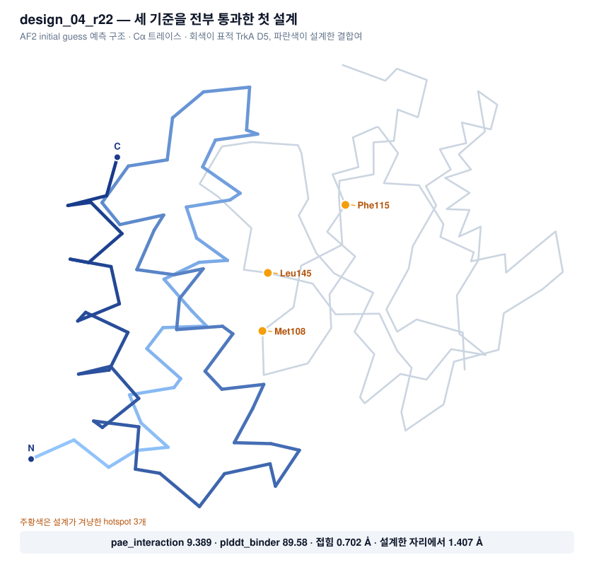

# 집중 재추출 — 백본 1개 × 서열 50 (v0.3.0)

[results/2026-11-19-design04-focus](../results/2026-11-19-design04-focus) · 코드 `52fb969` ·
2026-11-19 · Colab T4 · 34.1분

[앞 실행](04-scale-run.md)에서 백본 `design_04`가 배치 1.190 Å에 `pae_interaction`
12.934. 백본의 한계인지 서열 추출 수의 문제인지 서열 8개로는 구분되지 않음. 같은 백본에
서열 50개를 새로 뽑아 구분.

## 결과

| 항목 | 값 |
| --- | --- |
| 채점 | 50개 (백본 1개 × 서열 50) + 대조군 1 |
| 세 기준 전부 통과 | **1개 — `design_04_r22`** |
| 대조군 TrkA_88 | 5.862, 통과 |

| `design_04_r22` | 값 | 기준 |
| --- | --- | --- |
| `pae_interaction` | **9.389** | < 10 |
| `plddt_binder` | **89.58** | > 80 |
| 접힘 `binder_aligned_rmsd` | **0.702 Å** | < 1 |
| 배치 `target_aligned_rmsd` | 1.407 Å | 대조군 1.497 |

```
ALTAEEQAMIADATALVVYMNANAPRPFTREEMFAAARSYIRSLVRRKEIPELSEERIDALARLATERALALL
```



**한계 지점은 서열 추출 수.**

## 백본별 분포 비교

| 항목 | 넓은 실행 (백본 20 × 서열 8) | 이 백본 (서열 50) |
| --- | --- | --- |
| `plddt_binder` > 80 | 126/160 (79%) | **50/50** |
| 접힘 < 1 Å | 63/160 (39%) | **47/50** |
| 배치 < 5 Å | 11/160 (6.9%) | **41/50** |
| `pae_interaction` < 20 | 10/160 (6.3%) | **27/50** |
| `pae_interaction` 중앙값 | 26.402 | **19.788** |

넓은 실행의 중앙값 26.4는 계면 미예측 영역. 이 백본은 19.8, 절반 이상이 20 아래.
앞 실행에서 백본 20개 중 19개가 서열 8개를 전부 평탄면에 묻은 것과 대비.

## 서열 8개로 탐지되지 않은 이유

v0.2.0의 서열 8개(MPNN seed 0)와 이번 50개(seed 1–5)는 겹치지 않음. 50개 전부 고유.

| 표본 | 개수 | `pae` 최소 | `pae` 중앙값 |
| --- | --- | --- | --- |
| v0.2.0 | 8 | 12.934 | 18.794 |
| 이번 | 50 | **9.389** | 19.788 |

두 표본의 분포가 사실상 동일. 통과율 1/50 = 2%에서 8개를 뽑아 하나도 통과하지 못할
확률은 0.98⁸ = **85%**.

[04-scale-run](04-scale-run.md)에서 서열 축소 제안을 철회한 것과 같은 지점.

## 통과의 범위

| 항목 | 값 |
| --- | --- |
| 이 표적에서 필터 통과 후 실제 결합 | 6/95 = 6.3% ([교정](02-filter-calibration.md)) |
| 같은 교정 집합에서 실험상 비결합이 필터 통과 | 14/14 |
| 이 실행의 통과 | 1개 |

## MPNN 점수

서열별 점수를 기록하려 했으나 결과 객체에 스칼라 속성 없음.

```
MPNN이 내놓은 스칼라: 없음
결과 객체: MPNNInferenceOutput
```

필드 이름을 추측하지 않고 객체가 가진 스칼라를 전부 훑는 방식으로 구현 — 부재가 로그에
기록됨. 점수가 배열·리스트 등 다른 층에 있을 수 있으므로 객체 구조를 직접 확인 후 재시도.

## 소요

| 단계 | 시간 |
| --- | --- |
| 백본 준비 (생성 없음) | 0.7초 |
| MPNN 서열 50개 | 36초 |
| AF2 채점 51회 | 1216초 |
| 설치 포함 전체 | **2048초 (34.1분)** |

JAX 컴파일 2회(98.3초, 99.2초) — 설계 73잔기, 대조군 93잔기. 나머지 49회 중앙값 9.08초.
설계당 23.8초로 넓은 실행 25.5초와 동일 수준.
